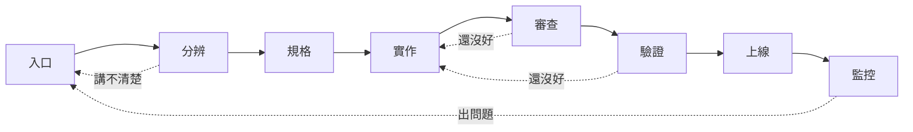

# chaol

**腳手架產生工廠，工廠產生產品。**

這個 repo 是最上面那一層。

---

## 一、腳手架、工廠、產品

這三個不同層，一層產生下一層。

|         | 它是什麼            | 它的產出 |
| ------- | --------------- | ---- |
| **腳手架** | 此 repo          | 工廠   |
| **工廠**  | 產品的每一個新版都從它出來 | 產品   |
| **產品**  | 終端使用者實際在用的那個網站或服務  | —    |

拿造車來類比：你想要一台車，但你先蓋一座造車廠。而這個 repo 是輔助你蓋**造車廠的腳手架**。

腳手架會將工廠產生到隔壁目錄，不在這個 repo 裡。這個 repo 只有腳手架與範本。

### 為什麼中間要多一層工廠

蓋一座造車廠划不划算，看的不是第一台車，是第一千台。

現在的大家開發普遍做法是**直接叫 agent 做產品**。第一版這樣最快。

但產品上線那天並不是代表結束 —— 改需求、修 bug、升依賴、補資安，沒有盡頭。

每一版都要有人在對的點說可以，要有證據證明它真的做到了，還要記得這一版目前走到哪。

**所以要蓋的不是產品，是那座迭代產品版本的工廠。** 

而那一千台是存在的：**它們不是一千個產品，是同一個產品的第一版到第一千版。**

這也是為什麼交付的是工廠，不是產品。維護沒有盡頭，生產工具就要屬於廠主本人。

### 名詞是強制的

`CONTEXT.md` 是這個專案的名詞表。它不是參考資料，是規則。

寫這個 repo 的任何文件之前先讀它。只用表上的詞，不要替換成同義詞。

理由在第二節。

---

## 二、這個專案要解的問題

### 2.1 軟體工廠

軟體工廠的意思是：**軟體開發生命週期原封不動，只有執行者從人換成 agent。**

需求、設計、實作、測試、部署、維運。

站還是那幾站，順序還是那個順序。變的只有兩件事：

1. 每一站的執行者是 agent。
2. 人只留在「判斷這樣對不對」的關卡上。

#### 廠主與工人

|        | 是人嗎           | 做什麼             |
| ------ | ------------- | --------------- |
| **廠主** | **是。而且是唯一的人** | 在關卡上監督。他不執行任何一站 |
| **工人** | 不是，是 agent    | 執行某一站的工作。它沒有判定權 |

工人每一輪重建，記不住上一輪。它靠 skill 與脈絡知道該做什麼。

「工人」是名詞表上的詞。中文行文一律這樣寫，不寫 agent。

### 2.2 如果廠主不是工程師

**這個專案也有假設廠主不是工程師。**

要問的是：一個沒有程式判斷力的人，能不能擁有並操作一座工廠。

那個人在這個專案裡叫**民眾**。整座工廠的設計繞著一句話轉：

> 民眾有品味。民眾判斷得出產品對不對，判斷不出程式碼對不對。

品味是自動化之後唯一不能被自動化的輸入，而民眾剛好有的就是這個。

所以要解的不是「怎麼讓民眾看懂程式碼」，而是：

> 怎麼在沒有人看程式碼的情況下，讓那一關還成立。

### 2.3 三個層級

廠主的工程背景分三級。層級決定每一站拉不拉人進來，以及拉進來看什麼。

| 層級 | 廠主 | 代替「審程式碼」的做法 | 狀態 |
|---|---|---|---|
| L1 | 民眾 | 只看高風險項的風險說明 | 未開放 |
| L2 | 稍有背景 | diff 摘要加完整風險說明 | 未開放 |
| L3 | 工程師 | 完整 PR review | **進行中** |

**現在只實作 L3。** L1 與 L2 保留成設計，因為它們決定現在要留哪些接縫。

例如「審產品看證據」三層完全一樣。所以證據的設計不能只為 L3 最佳化。

---

## 三、兩條產線

**產線有兩種，意思完全不同。** 

|          | 誰產生誰     | 幾站  | 什麼時候跑                  |
| -------- | -------- | --- | ---------------------- |
| **建廠產線** | 腳手架產生工廠  | 六站  | 開一座新工廠。之後腳手架每出一版再跑一次升級 |
| **產品產線** | 工廠產生產品新版 | 八站  | 每一筆任務。廠主說一句話就跑一輪       |

### 3.1 產品產線八站

| 站 | 什麼觸發它 | 做什麼 | 產出 |
|---|---|---|---|
| 入口 | 任務身上還沒有 `fac-` 標籤 | 把需求變成任務 | 一個 GitHub issue |
| 分辨 | `fac-triage` | 判斷是什麼、該不該做、簡單還是複雜 | 標籤與路線 |
| 規格 | `fac-needs-spec` | 複雜的先寫規格。簡單的直接做 | 白話規格 |
| 實作 | `fac-ready` | 寫程式碼 | 一個 PR |
| 審查 | `fac-in-pr` | 標出這次變更碰到了什麼 | 風險說明 |
| 驗證 | `fac-review-clean` 或 `fac-review-flagged` | 讓電腦實際操作產品 | 證據，然後貼 `fac-evidence` |
| 上線 | 廠主合併了 PR | 部署 | 上線的產品 |
| 監控 | 排程 | 盯產品有沒有壞、有沒有被用 | 新任務 |

**標籤就是任務的狀態，而且廠主不叫 skill。** 標籤變了，分派層照這張表決定下一個工人是誰。

有四個標籤刻意不派工：`fac-needs-info`、`fac-needs-decision`、`fac-evidence`、`fac-wont-do`。它們在等人。**那就是關卡的實作** —— 人不出手，任務就不動。

三條回頭的箭頭：

| | 從哪回到哪 | 什麼時候 |
|---|---|---|
| 1 | 分辨 → 入口 | 任務講不清楚，回去問廠主 |
| 2 | 審查或驗證 → 實作 | 判定還沒好，回去再跑一輪 |
| 3 | 監控 → 入口 | 產品出問題，變成新任務 |

**這三條是這張圖的重點。** 沒有回頭箭頭的自動化只是把錯誤推得更快。

### 3.2 建廠產線六站

| 站 | 做什麼 |
|---|---|
| 1 定產品型態 | 問產品是什麼、怎麼打開、要不要登入、會不會存別人的個人資料 |
| 2 開 repo | repo、標籤、分支保護、CI 骨架 |
| 3 接合約 | 接通每個 PR 的預覽、初始資料的重置、測試帳號。預覽與生產分成兩個專案。**廠主在這裡挑平台** |
| 4 寫合約宣告 | 把預覽網址、重置指令、測試帳號的環境變數名字寫進 `.factory/contract.json` |
| 5 驗收 | 對一個空產品跑一次驗證站 |
| 6 交付 | 把 repo 交給廠主 |

第 5 站的標準只有一條：**驗證站跑得出證據。**

這六站是**第一次**建廠。工廠升級與拆廠是同一條線上的另外兩站，還沒蓋。見 5.2。

工廠在能證明自己會驗證的那一刻才算建好。

#### 每一站是骨架加一格可選

建廠不是一路問到底，也不是一路自動。

| 站 | 骨架。定死 | 那一格 |
|---|---|---|
| 1 | 問哪幾題、對照表怎麼查 | 沒有。型態是查出來的 |
| 2 | 標籤名稱、分支保護、CI 要擋的四項 | 起始技術棧 |
| 3 | 預覽機制要滿足的五條。見 6.3 | **哪一家平台** |
| 4 | 合約宣告的欄位表 | 每一格的值 |
| 5 | 驗證站跑得出證據 | 沒有 |
| 6 | 交出去的是一座會驗證自己的工廠 | 交付的形式 |

**問廠主的永遠是那一格，骨架不問。** 問他要不要用 GitHub label 當狀態機是在浪費他的注意力 —— 共用 skill 依賴它，答「不要」工廠就不成立。

那一格要給常見做法當預設值。**預設值的用途是讓他有東西可以反對** —— 一張空白的問題比一個可以改的答案難回答得多。

有預設值就不答也走得下去，所以給選項不等於多一個關卡。**第 3 站是唯一的例外**：它要花廠主的錢，用他的帳號，所以 L3 一定要他選。

### 3.3 建廠不問產品規格

這條線上**沒有一站讀白話規格**。驗收用的是一個空產品 —— 不需要功能，只需要合約三項成立。

所以建廠只問產品是什麼、怎麼打開、要不要登入，以及會不會存別人的個人資料。

**白話規格是工廠建好之後第一筆任務的事。** 它走完整的產品產線，在規格站經過三道核准。

「這是我要的嗎」那一關沒有消失。它搬到了它本來該在的位置。

---

## 四、三個關卡

L3 的配置。三個關卡，其他五站上面一個人都沒有。

| 關卡 | 你看什麼 | 你決定什麼 |
|---|---|---|
| 規格 | 白話規格加技術規格 | 這是我要的嗎 |
| 審查 | 風險說明 | 這個改動我接受嗎 |
| 驗證 | 證據。錄影與截圖 | 它真的做到了嗎 |

三個關卡擺在三個不同的問題上。它們不重複。

### 4.1 審查站的產出不是通過與否

是一份**風險說明**。

人審程式碼久了會變成風險管理：碰到權限、金流、資料遷移就看，改個文案就不看。

要做到這件事，必須有一站先標出風險等級。那一站就是審查站。

硬規則：**最多 5 點。一點都沒有就是 clean，不要硬湊。**

湊出來的點會讓廠主下次不信任這個標記。

### 4.2 什麼時候廠主一定要讀 diff

風險說明回答「要不要看」。這張表回答「一定要看嗎」。

兩個問題：**好不好撤銷、影響多少人。**

| | 小範圍 | 大範圍 |
|---|---|---|
| **好撤銷** | 直接合併 | 看風險說明與證據 |
| **難撤銷** | **要廠主簽名認帳** | **廠主逐行讀 diff。沒有例外** |

**縱軸是可逆性，不是難度。** 難度是寫程式的人的主觀感受，可逆性是出事之後的客觀事實。而這座工廠賭的就是出事收得回來 —— 一旦可逆性不成立，賭注本身就不成立，關卡再多也補不回來。

左下那一格要的是**有人認帳**，不是有人看完。簽名的人沒讀 diff，但他知道自己在賭什麼。

這兩個軸由審查站判，寫在風險說明的第一行。

**右下那一格對 L1 不成立**，因為民眾讀不了 diff。所以對 L1 它要用架構消掉，不是用關卡守：migration 一律可逆，一次只改一件事並藏在開關後面。

### 4.3 空關卡比沒有關卡更糟

關卡最危險的失效方式不是被拿掉，是**還在但沒有人真的在上面判斷**。

沒有核准章的時候，下游知道自己在踩空地，所以會自己再查一次。有一枚假的章，下游就停止查了。

而這是制度問題，不是態度問題：**按下通過的成本是零，提出問題要花時間。** 所以要改機制，不是要求廠主認真一點。

這座工廠用一條機械檢查擋最明顯的那種：上線站比時間，**合併要晚於證據貼上**。早於就表示那時候根本沒有東西可以看。

### 4.4 驗證站只產證據，不做判定

第一版的驗證站是**證據產生器**，不是判定者。

| | 做什麼 | 判錯成本 | 第一版 |
|---|---|---|---|
| 證據產生器 | 讓電腦實際操作產品，產出錄影與截圖 | 趨近於零。它不決定任何事 | 要 |
| 判定者 | 依證據決定能不能出貨 | 高。壞的改動會上線 | 不要 |

**證據要讓廠主三秒看懂。一份需要閱讀的報告不是證據。**

---

## 五、工廠的四個元件

一座工廠要有四個元件。缺一不可。

| 元件 | 內容 | 拿掉會怎樣 |
|---|---|---|
| 自動化 | 產品產線自己會跑 | — |
| 脈絡與 skill | 工人知道這座工廠的慣例與不變量 | 工人非常一致地做錯事 |
| 關卡 | 在對的時機把人拉進來 | 錯誤以機器的速度被放大，而且沒有人會發現 |
| 自我改善 | 外迴圈觀察並修改 skill | 工廠永遠停在第一天的水準 |

前三項決定工廠的起始水準。**第四項決定它的斜率。**

### 5.1 內迴圈與外迴圈

| | 做什麼 |
|---|---|
| 內迴圈 | 一站照它的 skill 做事 |
| 外迴圈 | 觀察內迴圈的產出，並以 PR 修改 skill |

**自我改善不需要訓練模型。改一份 skill 並送 PR 就是外迴圈。**

但外迴圈證明不了自己在變好，除非有東西量它。**改一條 skill 跟改一行程式碼是同一件事，所以它也要回歸測試。**

那個回歸測試叫**重播集**：每一筆跑完的任務留下起點的 commit、廠主原話、合併的 PR 與當時的證據。四樣都是帳本的副產品，不用另外標註。改 skill 之前跑一次，改完再跑一次。

沒有差別的那一條規則要丟掉。**那是規範不膨脹的唯一防線** —— skill 與脈絡每一輪都被載入，所以它們的長度就是每一輪的成本。

### 5.2 工廠進步與產品進步是兩件事

產品一版一版變好，是工廠在跑產品產線。**工廠自己變好是另一件事，而且有兩個來源。**

| 迭代的是 | 誰做 | 怎麼做 | 廠主的事嗎 |
|---|---|---|---|
| 產品 | 工廠 | 產品產線跑一輪 | 是 |
| 工廠 | 這座工廠自己 | 外迴圈改產品產線的 skill 與脈絡 | 是 |
| 工廠 | 腳手架 | 升級站換掉共用那一半 | 只在升級的關卡上點頭 |
| 腳手架 | 腳手架自己 | 每次建廠卡在哪一站就是訊號 | **不是。那是腳手架 repo 的事** |

**一座工廠能自己改善的只有產品產線。** 它改得動的就是那條線的 skill 與脈絡，沒有別的 —— 工廠基礎設施由腳手架定死，共用層它不准本地改。

第三列表示建廠產線不只跑第一次。第二列只讓一座工廠變好，第三列讓每一座都變好。

升級不是什麼都能換。工廠的檔案分四類：共用層整批換、專屬層不碰、**死守那一類只檢查還在不在**、歷史只能新增。判準是「改錯之後廠主會不會發現」。

### 5.3 訊號從哪來

**修正訊號是人事後自己動手改掉的地方。**

人本來就會修。把修正動作留下來當訊號，是幾乎免費的標註資料。

例如廠主把 `fac-ready` 改成 `fac-needs-spec` —— 那表示分辨站的檢查表漏了一條。

但修正訊號要等人出手。所以還有第二個來源：**動作紀錄** —— 工人這一輪載入哪一份 skill、跑了哪些指令、讀寫哪些檔案、重試幾次。

| | 它說什麼 |
|---|---|
| 修正訊號 | 人覺得哪裡不對 |
| 動作紀錄 | 工人在哪裡卡住 |

**產出對不對看證據，過程對不對看動作紀錄。** 而推理文字丟掉 —— 推理是當下的雜訊，動作是發生過的事實。

一個例外要寫清楚：**審查站永遠不讀動作紀錄。** 它的價值完全來自看不到實作工人的假設。

### 5.4 工廠怎麼知道自己變好

四個指標，由監控站每輪記進工廠帳本。

| 指標 | 量什麼 |
|---|---|
| 交付量 | 上線了幾次 |
| 人的時間 | 廠主在關卡上花了多久 |
| token 時間 | 工人花了多少 |
| **判準落差** | 證據全過，廠主卻說「這不是我要的」的次數 |

**前三個量工廠跑得好不好。第四個量判準對不對。**

驗證站不判定，它照 `SPEC.md` 的不變量產證據 —— 所以不變量就是判準，而判準也會寫錯。這一格直接接到這個專案的前提：品味要進工廠，就必須先被寫成不變量，而寫得準不準，不量就不知道。

帳本還記一欄**規範長度**。skill 與脈絡每一輪都被載入，所以它們的長度就是每一輪的成本下界。規範變長而判準落差沒下降，就是在付錢買噪音。

#### 四個指標都會被鑽

| 指標 | 怎麼被鑽 |
|---|---|
| 交付量 | 把一筆任務拆成五筆 |
| 人的時間 | 讓廠主少看。關卡變成空關卡 |
| token 時間 | 把難的任務判成不該做 |
| 判準落差 | 廠主不看證據就合併，落差自然是零 |

**讓工人從自己的失敗學習，很容易學成「騙過判準」而不是「真的變好」。**

所以盯目標函數有沒有被鑽，是人的工作。它不在任何一站上面。

---

## 六、一份 skill 服務多座工廠

這是腳手架與單一座工廠最大的差別。

### 6.1 skill 分兩層

| 層 | 前綴 | 從哪來 | 可以改嗎 |
|---|---|---|---|
| 共用 | `fac-` | 腳手架 | **不可以。**升級時整批換 |
| 專屬 | 無前綴 | 這座工廠 | 可以 |

「不可以改」用**雜湊比對**強制，不用權限。改過就偵測得到，升級會停下來回報。

工廠想改共用 skill → **對腳手架送一個 PR。** 那是跨工廠學習的唯一路徑。

### 6.2 產品合約

一份共用 skill 要服務所有工廠，它必須有固定的事實可以依賴。

那組事實是**產品合約**。三項要求：

| | 要求 |
|---|---|
| 一 | 每個 PR 一個可以被操作的預覽 |
| 二 | 一組可重現的初始資料 |
| 三 | 一個固定的登入方式 |

三項都是驗證站要的。沒有預覽，證據產生器無從操作產品。

**合約刻意不限制程式語言、框架、資料庫與目錄結構。** 工廠不管產品怎麼寫。

產品用一份**合約宣告**告訴工廠「我這三項長什麼樣」。工廠讀宣告，不猜。

### 6.3 技術分兩邊，處理方式相反

| | 工廠基礎設施 | 產品技術 |
|---|---|---|
| 是什麼 | 隊列、預覽機制要滿足的要求、執行層隔離 | 語言、框架、資料庫、目錄結構 |
| 每座工廠 | 一樣 | 不一樣 |
| 腳手架 | **定死** | **不碰** |

基礎設施要穩固，因為 skill 依賴它。一個會變的基礎設施等於沒有基礎設施。

產品技術不碰，因為 skill 一旦長出技術棧分支，跨工廠學習就斷了。

**技術棧是起始值，不是決定。** 一筆任務換得掉。

**部署平台也是。** 腳手架定的是預覽機制要滿足的五條 —— 每個 PR 一個預覽、位置猜不到、機器帶 token 進得去、預覽與生產分成兩個專案、密鑰由平台注入。哪一家平台滿足它們，不是腳手架的決定。

---

## 七、資安靠架構擋，不靠關卡擋

功能壞了，廠主看證據就看出來。

**但資料外洩不會出現在錄影裡。** 畫面看起來完全正常。

> 民眾不審程式碼，所以民眾不會發現資安問題。

所以資安不能靠關卡擋，必須靠架構擋。

### 7.1 四層防線，強度遞減

| 層 | 強度 | 違規會怎樣 |
|---|---|---|
| 架構 | 最強 | 物理上做不到 |
| CI／靜態分析 | 強 | CI 紅 |
| rules | 弱 | 工人會忘 |
| skill | 最弱 | 工人會忘 |

**一條規則能放在架構層就不要放 CI 層，能放 CI 層就不要放 rules 層。**

### 7.2 第一條架構規則

**前端不持有任何可以直接存取資料的憑證。**

- 禁止 anon key 進前端
- 禁止 access token 進瀏覽器的儲存空間
- 允許 OAuth 重導向 —— 它不帶憑證，它去拿憑證，而憑證落在 server
- 允許 HttpOnly session cookie —— JS 讀不到的憑證前端就不算持有

代價是沒有即時訂閱，因為那需要前端持有 token。這個代價已經接受。

---

## 八、目前狀態

### 8.1 已經有的

| | 內容 |
|---|---|
| 設計文件 | `docs/` 六份。見第九節 |
| 名詞表 | `CONTEXT.md`。強制 |
| 工廠範本 | `template/`。操作手冊、名詞表、規格範本、帳本 |
| 共用 skill | 十一份。八站加外迴圈三份 |
| 合約宣告範本 | `template/.factory/contract.json` |
| 共用資安規則 | `template/.factory/security.md` |
| 腳本 | 三支。建廠、共用檔案的雜湊、派工 |
| 第一個產品 | **控制台。**第 1 站的四個答案已經定了 |

### 8.2 還缺的

| 缺什麼 | 為什麼卡住 |
|---|---|
| **起一個工人那一步** | 派工表有了程式（`scripts/dispatch.py`），但「怎麼起一個工人」刻意留成一個環境變數。隔離 worktree 與乾淨 session 也還沒有人建 |
| **第一座工廠** | 一座都還沒建。第 1 站的答案已經有了（產品是控制台），剩下一個平台帳號 |
| **工廠升級站** | 共用 skill 改好之後，沒有一站把它換進已經存在的工廠 |
| **回滾** | 上線站不回滾，所以那是廠主的事。但沒寫他要怎麼做 |
| **重播集** | 格式與位置沒定。而且它要等第一批任務跑完才有案例 |
| `.factory/checks.json` | CI 四項檢查的指令宣告。格式還沒定 |

**skill 寫完不等於產線會跑。** 現在最大的那一塊是第一座工廠 —— 沒有它，派工沒有東西可以對著跑。

### 8.3 程式碼只有三支腳本，而且沒有跑過一輪

| 腳本 | 做什麼 |
|---|---|
| `scripts/new-factory.sh` | 從範本產生一座工廠 |
| `scripts/shared-hashes.py` | 算共用檔案的雜湊。建廠時寫，升級時比對 |
| `scripts/dispatch.py` | 派工。標籤 → skill |

三支都沒有相依套件：bash、python3 標準庫、git、`gh`。沒有建置、沒有測試框架、沒有 lint。

**而這一整套設計沒有被執行過一次。** 沒有一座工廠被建出來，所以「驗證站跑得出證據」這條驗收標準到今天還是紙上的。

設計已經過剩，驗證是零。**下一步不是再加一節設計，是把它跑起來。**

### 8.4 下一步，依序

| | 做什麼 | 誰 |
|---|---|---|
| 1 | ~~答第 1 站那四題~~ **已定。產品是控制台**，見 `CLAUDE.md`「第一座工廠：第 1 站的答案」 | 廠主 |
| 2 | 開一個平台帳號，並對 6.3 那五條 | **廠主** |
| 3 | 跑 `new-factory.sh`、接合約、寫合約宣告 | 工人 |
| 4 | 第 5 站驗收。對空產品跑一次驗證站 | 工人產證據，**廠主看** |
| 5 | 第一筆任務：白話規格。走完整的產品產線 | 兩邊 |

**第 1 步要的不是規格，是四個答案。** 白話規格是第 5 步的事 —— 建廠產線從頭到尾不讀它，見 3.3。

**沒有任何一步需要刪掉工廠再重建。** 工廠建好的時候是空的，而空產品就是真產品的起始狀態。

第 1 步那一句話的用途是命名 repo 與工廠。所以萬一後來想做的是別的東西，代價是改一個名字，不是重建。

---

## 九、閱讀順序

| 順序 | 檔案 | 內容 |
|---|---|---|
| 1 | `CONTEXT.md` | 名詞表。**強制。先讀** |
| 2 | `docs/factory.md` | 產品產線：四個元件、技術的分界線、四層架構、保留清單、動作紀錄、八站、標籤狀態機、派工表、四格表、爆炸半徑、層級、自我改善、重播集、量測、指標怎麼被鑽 |
| 3 | `docs/factory-setup.md` | 建廠產線：六站、為什麼不問產品規格、第一站問什麼、驗收標準 |
| 4 | `docs/product-contract.md` | 合約三項要求、合約宣告的欄位、換技術棧要改哪些檔案 |
| 5 | `docs/security.md` | 四層防線的排序、五條架構層規則 |
| 6 | `docs/skills-layering.md` | 共用與專屬兩層、雜湊比對、跨工廠學習 |
| 7 | `docs/spec-format.md` | 產品層級與功能層級的規格格式 |

`CLAUDE.md` 是給在腳手架裡工作的工人看的。它有兩張清單：已經決定的事，與還沒決定的事。

`template/CLAUDE.md` 是給在工廠裡工作的工人看的。**兩份很容易改混。**

---

## 十、設計的出處

工廠模型的原始出處是一場演講：`Software Engineering Is Becoming Factory Engineering — Zach Lloyd, Warp`。

這個專案與那場演講的差別在三件事：

| | 演講 | 這個專案 |
|---|---|---|
| 廠主 | 假設是工程師 | 分三個層級。L1 是民眾 |
| 先蓋哪一站 | 分辨站。判錯成本最低 | **驗證站。**廠主最大的恐懼是不知道它做對了沒 |
| 產出 | 一座工廠 | 一套產生工廠的腳手架 |

產線的判準不是從演講重推的。它們來自一座已經跑過真實任務的工廠的實作經驗，而**那些判準已經全部寫進這個 repo** —— 審查站的三條硬規則、乾淨 session、標籤當狀態機、外迴圈的四條規則、規格的四個檔案。

所以讀這個 repo 不需要去讀別的 repo。

### 10.1 另外兩場演講

| 出處 | 拿了什麼 | 寫在哪 |
|---|---|---|
| *What Does an AI Engineer Do Now*（Arize AI） | 判準落差這個指標、一輪結束的保留清單、會重跑的那一步要冪等 | `docs/factory.md` 8.1、4.1、5.5.4 |
| *I Stopped Writing Code. Now I'm Stopping Code Review Too* | 可逆性乘影響範圍的四格表、空關卡、爆炸半徑與回滾、測試要先紅過 | 4.2、4.3，以及 `docs/factory.md` 5.2.1、5.1.1、5.6 |

兩場各有一項**刻意不拿**：

| 不拿 | 為什麼 |
|---|---|
| 不綁模型也不綁 harness | 這個 repo 的共用層就是 Claude Code 的 skill 檔。那是已知依賴，不是目標 |
| 四格表右下角要人逐行讀 | 那只設計給工程師。L1 讀不了，所以那一格要用架構消掉 |

---

## 十一、這個專案要回答的問題

這個 repo 不產生產品。它產生那座產生產品的工廠。

它要回答的問題是：

> 一個判斷不出程式碼對不對的人，能不能擁有一座工廠。
