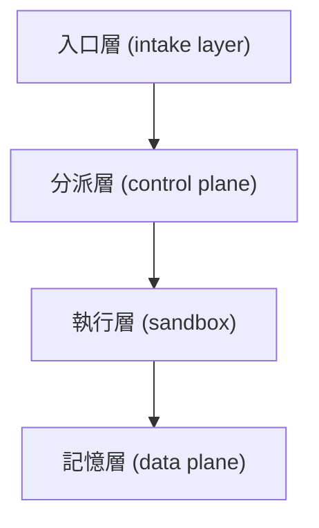
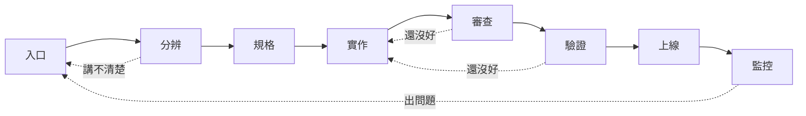
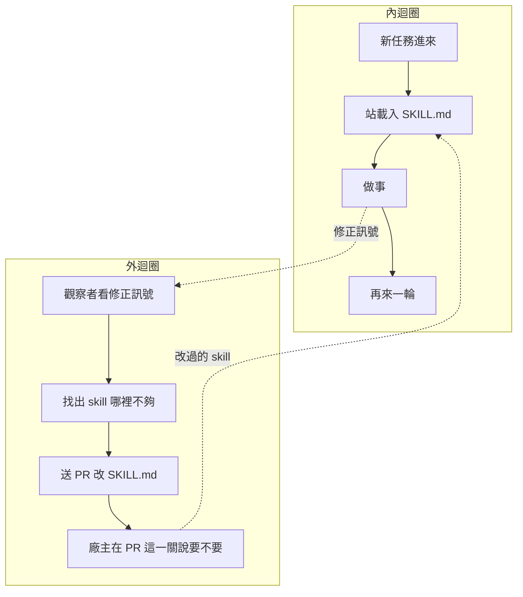

# 工廠設計

這份文件描述腳手架要產生的那座工廠。名詞一律照 `../CONTEXT.md`。

這份文件描述**產品產線** — 工廠怎麼產生產品。

腳手架怎麼產生一座工廠是另一條產線，叫**建廠產線**，寫在 `factory-setup.md`。兩條不要混。

---

## 1. 工廠是什麼

工廠是 SDLC 原封不動，只有執行者從人換成工人。

站還是那幾站，順序還是那個順序。變的只有兩件事：
1. 每一站的執行者是工人。
2. 人只留在關卡上。

這句話定義了整座工廠。它也定義了失敗的樣子：如果一座工廠需要人下去執行，它就不是工廠。

---

## 2. 四個元件

一座工廠要有四樣東西。缺一不可。

| 元件 | 內容 |
|---|---|
| 自動化 | 產品產線自己會跑，不必人逐次觸發 |
| 脈絡與 skill | 工人知道這座工廠的慣例與不變量 |
| 關卡 | 在對的時機把人拉進來 |
| 自我改善 | 外迴圈觀察失敗並修改 skill |

各拿掉一個就看得出為什麼缺一不可：

1. 只有自動化，沒有脈絡與 skill → 工人非常一致地做錯事。
2. 有前兩者，沒有關卡 → 錯誤以機器的速度被放大，而且沒有人會發現。
3. 三者都有，沒有自我改善 → 工廠永遠停在第一天的水準。同樣的誤判每次重犯。

前三項決定工廠的起始水準。第四項決定它的斜率。

### 2.1 工廠基礎設施與產品技術的分界線

這條線決定腳手架管什麼。**兩邊的處理方式相反。**

| | 工廠基礎設施 | 產品技術 |
|---|---|---|
| 是什麼 | 工廠運作本身要用的技術 | 產品怎麼寫 |
| 每座工廠 | 一樣 | 不一樣 |
| 腳手架 | **定死** | **不碰** |
| 寫在哪 | 共用 skill 與 `.factory/` | `docs/tech-spec.md`，專屬 |
| 要換的時候 | 改腳手架，所有工廠一起換 | 一筆任務，只換這座 |

#### 定死的那一邊

| 基礎設施 | 定了什麼 |
|---|---|
| 隊列 | GitHub issues |
| 任務狀態 | GitHub label 當狀態機。名稱見 5.3 |
| 審查與回滾 | GitHub PR |
| 執行層的隔離 | `git worktree` |
| 預覽機制 | 每個 PR 一個、位置不可猜測、service token 擋陌生人 |
| 專案分離 | 預覽與生產是不同專案、不同帳號 |
| 記憶層 | repo 裡的檔案 |
| 證據存放 | `.factory/evidence/pr-<編號>/` |
| 部署平台 | **還沒定。見第 9 節** |

**這一邊要穩固。** skill 依賴它，而一個會變的基礎設施等於沒有基礎設施。

所以「部署平台還沒定」不是一個可以拖的待決項。它是這張表唯一的洞。

#### 不碰的那一邊

語言、前端框架、資料庫、CSS 方案、目錄結構、測試框架。

合約刻意不限制這些。見 `product-contract.md` 第 6 節。

**唯一的例外是資安的架構層規則。** 它們限制架構，不限制產品技術 —— 任何技術棧都做得到「前端不持有憑證」。見 `security.md` 第 3 節。

#### 為什麼不能反過來

一份共用 skill 要服務所有工廠。它依賴的東西必須在每座工廠都一樣。

| skill 依賴 | 結果 |
|---|---|
| 工廠基礎設施 | 一份 skill 服務所有工廠 |
| 合約宣告 | 同上。宣告把產品的差異收成固定的幾個欄位 |
| 產品技術 | **skill 長出技術棧分支。跨工廠學習斷掉** |

最後那一列是真正的代價。一座工廠學到的東西傳不到用別套技術棧的工廠，而跨工廠學習本來是一座工廠工廠最大的價值。

#### 中間那一格

產品型態不在兩邊。它是**產品的事實**，不是技術選擇。

它由五題決定，而五題沒有一題提到技術。它決定預覽長什麼樣、證據是什麼形式。所以它必須在建廠時定。

見 `factory-setup.md` 4.2。

---

## 3. 層級：本專案的核心設計

原始的工廠模型把關卡的位置寫死：審規格、審 code、審產品。這假設廠主是工程師。

本專案把關卡參數化。同一座工廠，廠主的層級不同，拉人進來的站就不同。

這是本專案與原始模型最大的差別。

### 3.1 為什麼要分層級

民眾沒有程式判斷力。「審 code」那一關對民眾不存在。

但民眾有品味。他判斷得出產品對不對。品味是自動化之後唯一不能被自動化的輸入，而民眾剛好有的就是這個。

所以問題不是「怎麼讓民眾看懂 code」。問題是「怎麼在沒有人看 code 的情況下，讓那一關還成立」。

### 3.2 三個層級

| 層級 | 狀態 | 廠主 | 審白話規格 | 代替「審 code」的東西 | 審產品 | 改 skill |
|---|---|---|---|---|---|---|
| L1 | **未開放** | 民眾 | 白話規格 | 只看高風險項的風險說明 | 看證據 | 不可 |
| L2 | **未開放** | 稍有背景 | 白話規格 + 技術摘要 | diff 摘要 + 完整風險說明 | 看證據 | 由工人代筆送 PR |
| L3 | **進行中** | 工程師 | 白話規格 + 技術規格 | 完整 PR review | 看證據 | 直接改 |

**現在只實作 L3。** L1 與 L2 是設計保留，未來會存在。見 `../CLAUDE.md` 的「範圍」。

保留它們而不刪掉，是因為它們決定了現在的設計要留哪些接縫。例如「審產品看證據」三層一樣，所以證據的設計不能只為 L3 最佳化。

三層都有三個關卡。中間那一關的內容隨層級變，另外兩關不變。

「審產品看證據」三層完全一樣。證據本身不隨層級變。這是把驗證選成第一站的理由。

### 3.3 層級怎麼存

層級是工廠的設定，不是權限等級。一座工廠的層級可以往上調。

L1 的廠主學會之後升到 L2，升級的意思是「多一些站會拉他進來」，不是「解鎖功能」。

層級切換的機制現在不做 —— 只有一層就不用切。但設定欄位要留，不然以後要改所有工廠。

---

## 4. 架構

四層。上面三層可以換掉，最下面一層不能丟。

| 層 | 裡面有什麼 |
|---|---|
| 入口層 | L1 聊天訊息。L2 聊天訊息或直接開任務。L3 任務、PR 或 CLI。**全部收斂成 GitHub issue** |
| 分派層 | 下一站是哪一站、這座工廠是哪個層級、這一站要不要拉人進來 |
| 執行層 | 工作真的發生的地方。跑哪個工人、用哪個模型 |
| 記憶層 | skill、白話規格、技術規格、證據、修正訊號、歷史。**唯一跨執行留存的一層** |

分派層與執行層分開，是為了讓策略獨立於執行而變。換模型不該影響任務怎麼流動。

記憶層最重要。執行層每次重建，模型本身無狀態，只有記憶層留下來。工廠會不會變好，物理上取決於這一層寫了什麼進去。

### 4.1 一輪結束留什麼、丟什麼

執行層每一輪拆掉重建，所以「什麼活得過一輪」要寫成一張清單。沒有清單，它就由實作決定，而實作會變。

| 留 | 丟 |
|---|---|
| 白話規格與技術規格 | 執行層本身。worktree、暫存檔 |
| `specs/<feature>/` 的三份文件與 `spec.json` | 這一輪的對話 |
| 證據 | 這一輪拿到的憑證 |
| 修正訊號與工廠帳本 | 工人的中間推理 |
| 任務上的標籤 | — |

三條規則撐住這張表。

**一、留檔案，不留對話。** 把整段對話塞進下一輪，幾輪之後脈絡就爆掉，而且舊對話的雜訊會污染新判斷。留下來的要是結構化的檔案，下一輪只撈相關的那幾份。

審查站跑在乾淨 session 是同一條規則的特例。見 5.2。

**二、憑證短效，而且撤銷得掉。** 重點不是執行層關得住，是**漏出去也沒價值**。生產密鑰不進執行層已經是架構規則；這一條再加一層：進去的那些活不過這一輪。

**三、要有一次閒置掃描兜底。** 拆除流程一定有漏網的資源 —— 沒清掉的 worktree、沒回收的預覽、卡住的工作。所以掃描是獨立的，不掛在拆除流程後面。沒有兜底，漏掉的那些不會叫。

### 4.2 為什麼用 GitHub 當隊列

所有層級的入口都收斂成 GitHub issue。這樣免費得到五樣東西：

1. 任務隊列與標籤
2. PR 與 review 機制
3. 版本記錄
4. 回滾
5. 外迴圈需要的那條 PR 流程

L1 的廠主不必知道 GitHub 存在。入口層替他開任務，關卡層替他翻譯。

---

## 5. 產品產線八站

三條回頭的箭頭：

| | 從哪回到哪 | 什麼時候 |
|---|---|---|
| 1 | 分辨 → 入口 | 任務講不清楚，回去問廠主 |
| 2 | 審查或驗證 → 實作 | 判定還沒好，回去再跑一輪 |
| 3 | 監控 → 入口 | 產品出問題，變成新任務 |

**這三條才是這張圖的資訊。** 沒有回頭箭頭的自動化只是把錯誤推得更快。有回流才需要記憶層管狀態。

| 站 | 做什麼 | 產出 |
|---|---|---|
| 入口 | 把廠主說的話變成任務 | 一個 GitHub issue |
| 分辨 | 判斷這筆任務是什麼、該不該做、簡單還是複雜 | 標籤與路線 |
| 規格 | 簡單的直接做。複雜的先寫白話規格，必要時寫技術規格 | 白話規格（+ 技術規格） |
| 實作 | 在執行層寫 code | 一個 PR |
| 審查 | 標出這次變更碰到了什麼 | 風險說明 |
| 驗證 | 讓電腦實際操作產品 | 證據 |
| 上線 | 部署 | 上線的產品 |
| 監控 | 盯產品有沒有壞、有沒有被用 | 新任務 |

### 5.1 關卡在哪裡

| 站 | L1（未開放） | L2（未開放） | **L3（進行中）** |
|---|---|---|---|
| 入口 | — | — | — |
| 分辨 | — | — | — |
| 規格 | 關卡 | 關卡 | **關卡** |
| 實作 | — | — | — |
| 審查 | 關卡（只有高風險才問） | 關卡 | **關卡** |
| 驗證 | 關卡 | 關卡 | **關卡** |
| 上線 | — | — | — |
| 監控 | — | — | — |

實作、驗證、上線、監控上面一個人都沒有，除了驗證的那個關卡是「看證據」而不是「看怎麼做」。

### 5.1.1 空關卡比沒有關卡更糟

**關卡最危險的失效方式不是被拿掉，是還在但沒有人真的在上面判斷。**

沒有核准章的時候，下游知道自己在踩空地，所以會自己再查一次。有一枚假的章，下游就停止查了。所以空關卡消耗的不是時間，是「過了這一關」這句話的信用。

這是制度問題，不是態度問題。**按下通過的成本是零，提出問題要花時間。** 誘因長這樣，要求廠主認真一點不會有用，只能改機制。

這座工廠現在有一個已知的空關卡風險：

| 哪裡 | 為什麼 |
|---|---|
| 驗證關卡 | 上線站把「廠主合併了 PR」當成他的點頭。廠主沒看證據就合併，上線照跑 |

機制上的解法不是再問他一次 —— 那會讓他學到合併不算數。解法是比時間：**合併的時間要晚於證據貼上的時間。** 早於就表示他在證據還不存在的時候就合併了，那一關是空的，上線站停下來。

這一條擋不住「看了三秒就合併」。它只擋得住「根本沒有東西可以看」。剩下的那部分由判準落差那個指標長期量，見 8.1。

### 5.2 審查站的產出不是通過與否

審查站的產出是一份風險說明。

這一點決定 L1 工廠成不成立。人審 code 久了會變成風險管理：碰到權限、金流、資料遷移就看，改個文案就不看。要做到這件事，必須有東西先標出風險等級。

那個東西就是審查站。所以審查工人的真正職責是分級，不是放行。

L1 的風險說明要用廠主的語言寫。例如：

- 「這次改動會碰到付款，建議你看一下。」
- 「這次只改了文字，沒碰到資料。」

### 5.2.1 什麼時候廠主一定要讀 diff

風險說明回答「要不要看」。這張表回答「一定要看嗎」。

兩個問題：**好不好撤銷、影響多少人。**

| | 小範圍 | 大範圍 |
|---|---|---|
| **好撤銷** | 直接合併 | 看風險說明與證據 |
| **難撤銷** | **要廠主簽名認帳** | **廠主逐行讀 diff。沒有例外** |

#### 為什麼縱軸是可逆性，不是難度

難度是寫程式的人的主觀感受。可逆性是出事之後的客觀事實。

而這整套工廠賭的就是「出事收得回來」。**一旦可逆性不成立，賭注本身就不成立，關卡再多也補不回來。**

這跟這個專案別的地方用可逆性的方式是同一條：第一站蓋驗證因為它最可逆、分辨站不關任務因為關掉不可逆、拆廠要人確認因為它不可逆。差別只是這張表把可逆性從「選站的順序」搬到「每一筆變更」。

#### 簽名不等於讀完

左下那一格要的是**有人認帳**，不是有人看完。

它跟空關卡只差一件事：**簽名的人知道自己在賭什麼。** 他沒讀 diff，但他知道這一筆難撤銷，而他決定承擔。

#### 誰判這兩個軸

**審查站。** 它看得到 diff，所以它判得出影響範圍，也判得出有沒有不可逆的動作 —— migration、刪資料、改外部介面、動錢。

判完寫進風險說明的第一行，而不是藏在五點裡面。廠主要先知道這一筆落在哪一格。

#### 右下那一格對 L1 不成立

L1 的廠主讀不了 diff。所以對 L1 來說，右下那一格**不能用關卡解，要用架構讓它不存在**：

| 要求 | 效果 |
|---|---|
| migration 一律可逆 | 把難撤銷變成好撤銷 |
| 一次只改一件事，藏在開關後面 | 把大範圍變成小範圍 |

做不到這兩件的改動，L1 工廠就不該讓它上線。見第 9 節。

### 5.3 標籤當狀態機

隊列是 GitHub issues，任務的狀態就是它身上的標籤。這一格是工廠基礎設施，名稱定死。見 2.1。

用前綴，不用別的機制。標籤是一個扁平的集合，所以前綴是它唯一分得出層的辦法。

**一筆任務同時只帶一個狀態標籤。**

| 狀態標籤 | 意思 | 誰貼 |
|---|---|---|
| `fac-triage` | 待分辨 | 入口站 |
| `fac-ready` | 簡單，可以直接實作 | 分辨站、規格站 |
| `fac-needs-spec` | 複雜，要先寫白話規格 | 分辨站 |
| `fac-needs-info` | 講不清楚，等廠主補 | 分辨站 |
| `fac-needs-decision` | 要廠主決定，或內文有疑似指令 | 分辨站 |
| `fac-wont-do` | 判斷不該做。**任務留著** | 分辨站 |
| `fac-in-pr` | PR 開了 | 實作站 |
| `fac-review-clean` | 風險說明零點 | 審查站 |
| `fac-review-flagged` | 風險說明有幾點要看 | 審查站 |
| `fac-evidence` | 證據產出了，等驗證關卡 | 驗證站 |

類型標籤四個，不是狀態，貼上去不撕：`fac-kind-bug`、`fac-kind-feature`、`fac-kind-copy`、`fac-kind-chore`。

四個是上限。類型越少，`fac-improve-triage` 的改善越快。

上線之後關掉任務。沒有 `fac-shipped` 這個標籤 —— 關掉任務本身就是那個狀態。

### 5.4 簡單任務繞過規格關卡

分辨站判「簡單」的時候，那筆任務不經過規格關卡。

**那等於分辨站替廠主拿掉一個關卡。而分辨站上面沒有人。**

這件事成立的理由只有一個：**審查關卡還在。**

簡單任務跳過的是規格關卡，不是所有關卡。它照樣過審查與驗證兩關。所以分錯最壞是「做了一個廠主不要的小改動，在審查關卡被退回」—— 多走一趟。那正好是這一站判錯成本低的那個理由。

判準寫成六條檢查表，全部成立才算簡單。見 `fac-triage` 3.4。

兩邊的代價不對稱，所以有一條硬規則：**拿不定主意就判複雜。**

| 判錯的方向 | 代價 |
|---|---|
| 複雜的判成簡單 | 繞過規格關卡。廠主沒機會說「這不是我要的」 |
| 簡單的判成複雜 | 多寫一份白話規格 |

L1 與 L2 要重新看這一節。**它依賴「審查關卡的人看得懂 diff」。** L1 的審查關卡只看風險說明，吸收不了分錯的那一趟。

### 5.5 派工表

**廠主不叫 skill。** 標籤變了，分派層決定下一個工人是誰。

這張表就是分派層的全部規格。

| 觸發 | 載入哪一份 skill | 跑在哪 |
|---|---|---|
| 任務開了，身上沒有 `fac-` 標籤 | `fac-intake` | — |
| `fac-triage` | `fac-triage` | — |
| `fac-needs-spec` | `fac-spec` | — |
| `fac-ready` | `fac-implement` | **一個隔離的 worktree** |
| `fac-in-pr` | `fac-review` | **一個乾淨 session** |
| `fac-review-clean` 或 `fac-review-flagged` | `fac-verify` | — |
| 廠主合併了 PR | `fac-ship` | **唯一有部署權限的那一個** |
| 排程。每輪 | `fac-monitor` | — |
| 排程。每週 | `fac-improve-triage`、`fac-improve-review`、`fac-improve-verify` | — |

### 5.5.1 四個狀態不派工

| 標籤 | 在等誰 |
|---|---|
| `fac-needs-info` | 廠主補資訊 |
| `fac-needs-decision` | 廠主決定 |
| `fac-evidence` | 廠主看證據，然後合併或退回 |
| `fac-wont-do` | 廠主關掉任務 |

**這四個就是關卡與回頭箭頭的實作。** 分派層在這四個狀態上什麼都不做，所以人不出手，任務就不動。

一座工廠卡住的時候，看有幾筆任務停在這四個標籤上。那個數字就是「人的時間」這個指標的來源。

### 5.5.2 標籤是粗的，規格站的狀態是細的

規格站有三道核准，而標籤只有一個 `fac-needs-spec`。

細的狀態存在 `specs/<feature>/spec.json` 的 `phase` 與 `approvals`。

所以分派 `fac-spec` 的時候要連 `spec.json` 一起讀，不然分不出該產哪一道。**這是唯一一個標籤不足以決定下一步的站。**

### 5.5.3 標籤名字與站名不一定一樣

只有 `fac-triage` 這個標籤剛好對上同名的 skill。

其餘的標籤命名的是**狀態**，不是下一個工人。`fac-ready` 不是「ready 站」，它是「分辨完了，可以實作」。

**不要從標籤名字猜 skill。** 照這張表。

### 5.5.4 會重跑的那一步要冪等

派工會重跑。工人掛掉、執行層被回收、事件重送 —— 重跑的起點是**失敗的那一步本身**，不是它的下一步。

所以那一步只要有副作用，重跑就會做第二次：

| 有副作用的步驟 | 重跑兩次會怎樣 |
|---|---|
| 開 PR | 同一筆任務兩個 PR |
| 貼評論 | 證據貼兩份，廠主不知道看哪一份 |
| 部署 | 同一個版本上線兩次 |
| 建預覽 | 兩個預覽，證據可能錄到舊的那個 |
| 重置初始資料 | 這一步本來就該冪等，重置兩次結果一樣 |

規則：**會重跑的步驟，副作用要嘛冪等，要嘛帶一個去重的識別碼。**

上線站「失敗不重試、不回滾」就是這條規則的特例 —— 那一步的副作用改的是生產環境，而它上面沒有人。它選的是不重跑。

### 5.5.5 還缺執行它的那個東西

這張表寫完了，但**沒有任何東西在執行它**。

| 有 | 缺 |
|---|---|
| 十一份 skill | 收到「標籤變了」這個事件的東西 |
| 這張派工表 | 起一個工人並載入指定 skill 的東西 |
| 標籤狀態機 | 隔離 worktree 與乾淨 session 的建立 |

三種做法都行：webhook、輪詢、或廠主手動跑一個指令。一個都還沒有。

**在它出現之前，工廠不會自己轉。** 那不是 skill 的問題，skill 是完整的。

### 5.6 爆炸半徑與回滾

前面那些關卡都在提高攔截率。**這一節的兩件事預設攔截失敗**，改去壓縮損害。

| | 做什麼 |
|---|---|
| 小爆炸半徑 | 一次只改一件事，藏在開關後面 |
| 回滾 | 一步退回上一個好的版本 |

「藏在開關後面」是回滾做得到的前提 —— 退回去變成關一個開關，不是重新部署一次。「一次只改一件事」則讓人知道要關哪一個。

### 5.6.1 無法快速撤銷就不要這樣上線

這句話讀成**准入條件**比讀成補救手段有用。

它等於宣告：這整套流程只適用於可逆的改動。不可逆的那一類要走 5.2.1 右下那一格 —— 人逐行讀。

### 5.6.2 回滾是廠主的事，而這還沒寫完

上線站**失敗不重試、不回滾**，理由是那一站上面沒有人，而回滾會改生產環境。

所以回滾是廠主的事。但這座工廠現在沒寫他要怎麼做，也沒要求產品把回滾做成一步。見第 9 節。

---

## 6. 第一站蓋驗證

### 6.1 選擇

原始模型建議從分辨站入手，理由是它判錯成本最低：分錯類的任務下一站會被改回來，最壞是多走一趟。

本專案先蓋驗證站。理由是民眾最大的恐懼是「我不知道它做對了沒」。沒有證據，整座工廠對民眾就不可信，其他站蓋得再好也沒用。

### 6.2 但要拆成兩件事

原始模型警告過：驗證工人判錯會讓壞東西出貨。

這個警告只對「有判定權的驗證」成立。所以驗證站拆成兩件事，第一版只做第一件：

| | 做什麼 | 判錯成本 | 第一版 |
|---|---|---|---|
| 證據產生器 | 讓電腦實際操作產品，產出錄影、截圖、測試結果 | 趨近於零。它不決定任何事 | 要 |
| 判定者 | 依證據決定能不能出貨 | 高。壞東西會上線 | 不要 |

這樣同時成立兩件事：解掉民眾的信任問題，而且維持「從最可逆的那一站開始」這個原則。

判定權晚一點再交出去。交出去的前提是證據已經穩定，而且有人判過足夠多次。

### 6.3 證據的驗收標準

證據要讓廠主三秒看懂。

一份需要閱讀的報告不是證據。錄影與截圖是證據，因為它把驗證結果變成人可以直接判斷的東西。

---

## 7. 自我改善

### 7.1 機制

內迴圈照 skill 做事。外迴圈改 skill。

兩個迴圈接在兩個點上：內迴圈的產出變成外迴圈的輸入，外迴圈改過的 skill 被下一輪內迴圈載入。

自我改善不需要訓練模型。被改的對象是一份文字檔。

所以每一次改善都走一般的 PR 流程：可被審查、可被拒絕、可被回滾、有作者有時間戳。這把「系統自己改自己」這個聽起來危險的概念，壓進一個已經被信任的安全機制裡。

自我改善同樣需要人。人在 PR 那一關。

### 7.2 民眾工廠的訊號來源問題

原始模型的修正訊號是「資深工程師修正了審查工人的評論」。民眾工廠沒有資深工程師。

所以訊號只能從這三個地方來：

1. **廠主在關卡上否決了什麼，以及他重述需求的那句話。**
2. 廠主看完證據說「這不是我要的」。
3. 監控站抓到的線上問題。

第一種最有價值。它同時告訴你兩件事：工人誤解了什麼，以及正確的說法是什麼。這是幾乎免費的標註資料，因為廠主本來就會重述。

**第一版把第一種當唯一的訊號來源。這是假設，不是結論。** 要驗證的問題是：民眾的重述句夠不夠具體，足以讓觀察者寫出可用的 skill 修改。

### 7.3 L1 的外迴圈誰按 PR

L1 的廠主不可以改 skill，也看不到 PR。

那 L1 工廠的外迴圈由誰批准，是還沒解決的問題。見第 9 節。

---

## 8. 量測

四個指標：

1. **交付量** — 上線了幾次。
2. **人的時間** — 廠主在關卡上花了多久。
3. **token 時間** — 工人花了多少。
4. **判準落差** — 證據全過，廠主卻說「這不是我要的」的次數。

把人的時間與 token 時間並列很關鍵。優化目標不是少花錢，是換掉哪一種成本。把廠主的一小時換成十美元的 token 是好交易，反過來不是。

**這四個數字由監控站記進工廠帳本。** 見 `fac-monitor` 3.3。

### 8.1 第四個指標在量判準本身

前三個量工廠跑得好不好。第四個量**判準對不對**。

驗證站不判定，它照 `SPEC.md` 的不變量產證據。所以不變量就是那個判準，而判準也會寫錯。

| 落差高表示 | 不表示 |
|---|---|
| 不變量沒抓到廠主的品味 | 工人做錯了 |

這個指標直接接到這個專案的前提：民眾有品味，而品味要進工廠，就必須先被寫成不變量。**寫得準不準，不量就不知道。**

兩個配套的做法：

1. **退回的時候要記理由。** 只記「退回」看不出是不變量寫壞了，還是那一條根本沒寫。
2. **樣本數要一起記。** 五筆裡落差一筆，和五十筆裡落差十筆，意思完全不同。

落差不會歸零。它歸零通常表示廠主已經不看證據了 —— 那是 `fac-improve-verify` 訊號 E，比落差高嚴重。

沒有人記的時候，工廠有沒有變好就只剩感覺 —— 而帳本裡只會有「改了幾次」，沒有「人的時間有沒有變少」。

### 8.2 民眾工廠要再拆一次

「人的時間」對民眾工廠要分成兩種：

| 時間 | 性質 | 目標 |
|---|---|---|
| 說自己想要什麼 | 有價值的投入。這是品味進入工廠的唯一管道 | 不壓縮 |
| 搞懂工人在幹嘛 | 純損耗 | 壓到零 |

只有第二種要壓。把兩種混在一起量，會得到錯誤的結論：一座讓廠主完全不說話的工廠，指標很漂亮，但產品不會是他要的。

---

## 9. 還沒定的事

這些要先定，才寫得下去。

1. ~~技術棧~~ — **已定。**五種產品型態用三套技術棧，對照表在 `factory-setup.md` 4.2。合約的要求二已經決定走「共用一個資料庫，每輪重置」，並接受並行污染這個缺陷，見 `product-contract.md` 3.3。
2. **一座工廠對幾個產品** — 一工廠一產品，或一工廠一條產品線。
3. **誰跑腳手架** — 民眾自己跑，或由人幫他建好再交付。
4. **L1 的關卡怎麼送到廠主眼前** — 他看不到 GitHub，證據與風險說明要走哪個管道給他。
5. **判定權什麼時候交出去** — 證據穩定到什麼程度，才讓判定者上線。
6. **L1 外迴圈的批准者** — 見 7.3。
7. **修正訊號的假設要驗證** — 見 7.2。

### 9.1 這三項是這一輪新開的

1. **回滾要怎麼做。** 上線站不回滾，所以那是廠主的事，但沒寫他怎麼做。要不要要求產品把回滾做成一步，見 5.6.2。
2. **測試會不會失敗要不要量。** mutation testing 可以算成一個數字。要不要變成 CI 的第五項檢查，還沒定。
3. **L1 怎麼讓右下那一格不存在。** 要求 migration 可逆、一律藏在開關後面 —— 這兩條是架構層的要求，而現在只有 L3，所以還沒寫進任何地方。見 5.2.1。

---

## 10. 來源

工廠模型、四個元件、四層架構、產品產線八站、三條回頭箭頭、技能迴圈、三個量測指標，都出自這場演講：

Zach Lloyd (Warp)，*Software Engineering Is Becoming Factory Engineering*，AI Engineer，2026-09-27。
<https://www.youtube.com/watch?v=tUPPVhBBcoM>

本專案自己加的是這幾項：

1. 層級（第 3 節）。原始模型把關卡位置寫死。
2. 用風險說明代替民眾的「審 code」關卡（5.2）。
3. 驗證站拆成證據產生器與判定者，先蓋前者（第 6 節）。
4. 民眾工廠的修正訊號來源（7.2）。
5. 把人的時間拆成投入與損耗（8.2）。
6. 建廠產線。演講只講工廠怎麼運作，沒講工廠怎麼被建出來。見 `factory-setup.md`。
7. 產品合約。見 `product-contract.md`。

### 10.1 另外兩個來源

這三項出自另一場演講，不是上面那一場：

| 項目 | 哪一節 |
|---|---|
| 判準落差。量判準本身準不準 | 8.1 |
| 保留清單的三條規則 | 4.1 |
| 會重跑的那一步要冪等 | 5.5.4 |

Aparna Dhinakaran (Arize AI)，*What Does an AI Engineer Do Now*，AI Engineer，2026。

那場有一項**刻意不拿**：「不綁模型也不綁 harness」。這個 repo 的共用層就是 Claude Code 的 skill 檔，整套是綁的。那是已知依賴，不是目標。

第三場給的是關卡本身的設計：

| 項目 | 哪一節 |
|---|---|
| 可逆性乘影響範圍的四格表 | 5.2.1 |
| 空關卡比沒有關卡更糟 | 5.1.1 |
| 爆炸半徑與回滾 | 5.6 |
| 測試不會失敗就保護不了你 | 9.1 第 2 項 |

*I Stopped Writing Code. Now I'm Stopping Code Review Too*，2026。

那場的四格表只設計給工程師。右下那一格要求人逐行讀 diff，而 L1 的廠主做不到 —— 所以這個 repo 多推了一步：**那一格對 L1 要用架構消掉，不是用關卡守。**
