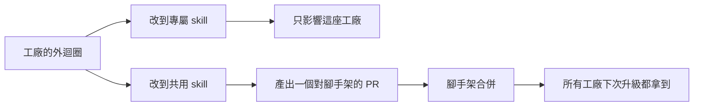

# skill 分層

這份文件定義一座工廠裡的 skill 分成哪兩層，以及工廠怎麼升級。名詞一律照 `../CONTEXT.md`。

這一項要在建立 `template/` 之前定，因為它決定目錄形狀。分錯了之後要搬。

---

## 1. 為什麼要分層

腳手架用複製範本的方式產生工廠。那表示：

```
腳手架改進  →  新的工廠拿到
            →  舊的工廠拿不到
```

而 `factory-setup.md` 第 6 節寫了腳手架的外迴圈 ——「每次建廠卡在哪一站就是修改建廠 skill 的訊號」。**那些改進到不了已經建好的工廠。**

反方向更嚴重：**一座工廠學到的東西，其他工廠拿不到。** 一座工廠工廠最大的價值本來就是跨工廠學習。

分層是為了讓升級能只換該換的那一半。

---

## 2. 用前綴分層，不用目錄

分層的標記是**命名前綴**，不是目錄。

| 前綴 | 性質 |
|---|---|
| `fac-` | 共用。跟產品無關，每座工廠一樣 |
| 無前綴 | 這座工廠專屬 |

**skill 的載入是扁平的 —— skill 的名字就是目錄名。** 所以目錄分不了層，前綴才分得了。

這一點與標籤一樣。見 `factory.md` 5.3。

---

## 3. 兩層

| 層 | 前綴 | 從哪來 | 可以改嗎 | 升級時 |
|---|---|---|---|---|
| **共用** | `fac-` | 腳手架 | **不可以** | 整批換掉 |
| **專屬** | 無前綴 | 這座工廠 | 可以 | 不碰 |

`fac` 取自 factory。

### 3.1 共用 skill

產品產線八站與建廠產線六站的 skill 都是共用的：

```
fac-intake      fac-triage      fac-spec        fac-implement
fac-review      fac-verify      fac-ship        fac-monitor
fac-improve-triage   fac-improve-review   fac-improve-verify
```

它們跟產品無關。每座工廠都一樣。

### 3.2 專屬 skill

這座工廠自己的東西。例如一座做訂位系統的工廠可能有一份 `booking-rules`。

專屬 skill 不受升級影響。

### 3.3 不只 skill

同一條線切下去，整座工廠的檔案都分兩層：

| 共用（`fac-` 或在 `.factory/` 裡） | 專屬 |
|---|---|
| `.claude/skills/fac-*/` | `.claude/skills/<其他>/` |
| `.factory/ci/`（CI 骨架） | `.github/workflows/`（這座工廠加的） |
| `CONTEXT.md` 的「工廠運作」那一節 | `CONTEXT.md` 的「這個產品」那一節 |
| `CLAUDE.md` 的「工廠運作」那幾節 | `CLAUDE.md` 的「這個產品」那幾節 |
| — | `SPEC.md`、`docs/tech-spec.md`、`specs/*` |

`CONTEXT.md` 與 `CLAUDE.md` 是混合的 —— 一個檔案裡兩層。所以它們的共用那幾節要標出來，而且升級時只換那幾節。

---

## 4. 「不可以改」怎麼強制

檔案系統權限做不到，也不該做 —— 廠主有時候需要臨時改一下看看。

改用**雜湊比對**。

每座工廠有一份 `.factory/manifest.json`：

```json
{
  "scaffold": {
    "version": "0.1.0",
    "commit": "35a915f"
  },
  "tier": "L3",
  "product_form": "pwa",
  "shared": {
    ".claude/skills/fac-verify/SKILL.md": "sha256:…",
    ".claude/skills/fac-review/SKILL.md": "sha256:…",
    ".factory/ci/pr-check.yml": "sha256:…"
  }
}
```

升級的時候比對每個共用檔案的雜湊：

| 情況 | 處理 |
|---|---|
| 雜湊一樣 | 直接換成新版 |
| 雜湊不一樣 | **停下來回報。**那份檔案被本地改過了 |

雜湊不一樣的時候不要自動合併。報給廠主，讓他決定：丟掉本地的改動，或者把那個改動送回腳手架（見第 5 節）。

這樣「不可以改」就不是一條 rules 層的規則，而是一個會被偵測到的狀態。照 `security.md` 第 2 節的排序，那是往上推了一層。

---

## 5. 跨工廠學習的路徑

工廠的外迴圈觀察修正訊號，產出一個改 skill 的 PR。那份 PR 改到哪一層，決定它影響多遠：



**工廠的外迴圈產出一個對腳手架的 PR。** 那就是跨工廠學習的機制。

它跟整套設計一致 —— 外迴圈的產物本來就是 PR，不是直接改檔案。見 `factory.md` 7.1。

### 5.1 一個後果

共用 skill 的改動要經過腳手架的審查。那表示一座工廠的改進不會立刻生效。

這是刻意的。一座工廠的特例被當成通則套到所有工廠，會把其他工廠弄壞。腳手架那一關就是在問「這是通則還是特例」。

---

## 6. 兩站補上

`factory-setup.md` 第 2 節的六站少了這兩站。它們都是工廠建好之後才會跑的，但它們屬於建廠產線，因為它們改的是工廠本身，不是產品。

### 6.1 工廠升級

| | |
|---|---|
| 觸發 | 腳手架有新版，或廠主手動要求 |
| 讀 | `.factory/manifest.json` |
| 做 | 比對共用檔案的雜湊，一樣的換掉，不一樣的回報 |
| 關卡 | **廠主確認要換**。有雜湊不符時一定要人看 |
| 驗收 | **跑一次驗證站**。與建廠第 5 站同一條標準 |

升級的驗收標準跟建廠一樣：驗證站跑得出證據。換了共用 skill 之後，工廠還要能證明自己會驗證。

**升級可以動哪些檔案、哪些要死守，見 `factory-setup.md` 2.2.2。** 這一站只換「共用」那一類，而死守那一類它只檢查還在不在。

### 6.2 拆廠

| | |
|---|---|
| 觸發 | 廠主不要這座工廠了 |
| 做 | 清掉預覽與生產兩個專案、部署平台的資源、repo 的 webhook |
| 關卡 | **廠主確認**。這一站不可逆 |

拆廠對個資規則特別重要。`factory-setup.md` 4.4.3 要求「刪除權」，而工廠自己被刪掉的時候，那些資料也要被刪掉。

拆廠要留一份清單：刪了什麼、什麼時候刪的。不留清單就無法證明資料真的刪了。

---

## 7. 還沒定的事

1. 腳手架的版本號怎麼決定。語意化版本，或直接用 commit。
2. ~~混合檔案怎麼只換共用那幾節~~ — **已定。**用 HTML 註解標界線：

   ```
   <!-- fac:shared:start -->
   …共用內容…
   <!-- fac:shared:end -->
   ```

   選它的理由是三個：在 Markdown 裡看不見、機器讀得出來、而且界線跟內容在同一個檔案裡所以不會走失。升級時只換這對標記之間的內容。
3. 拆廠的清單存在哪裡。工廠被刪了，清單也會跟著不見。
